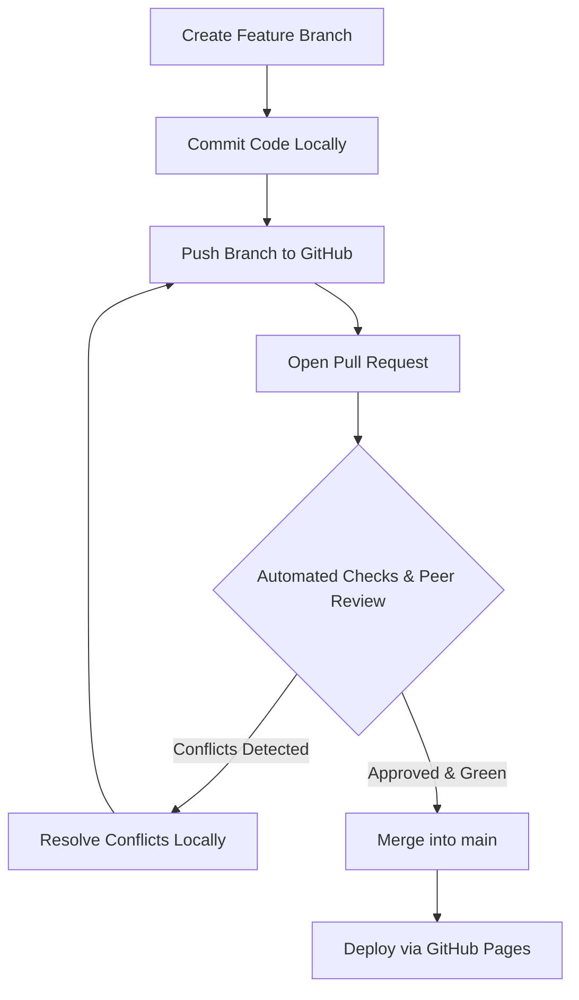

# Git Collaboration Workflow & Team Standards
**Project:** Team Recipe Book (`CulinaryCraft`)  
**Standardized Team Operational Handbook**

---

## 1. Branching Strategy
Our team adheres to a streamlined **Feature Branch Workflow**:

```text
[origin/main] ───────●─────────●──────────────● (Release v1.0)
                      \         \            /
[feature/breakfast]    ●───●     \          /
                            \     \        /
[feature/dinner]             ●─────●──────● (Conflict Resolved)
```

### 1.1 Branch Naming Conventions
- `main` — Production-ready branch. Direct pushes to `main` are restricted in production.
- `feature/<feature-name>` — For newly contributed features or sections (e.g., `feature/breakfast-recipes`, `feature/dinner-recipes`).
- `fix/<bug-name>` — For hotfixes or layout repairs.
- `docs/<topic>` — For documentation improvements.

---

## 2. Commit Message Standards
We follow the **Conventional Commits** specification:
```text
<type>(<scope>): <short description in present imperative tense>

[optional body explaining motivation and context]
```

### Examples:
- `feat(breakfast): add golden buttermilk pancakes recipe and card`
- `style(css): improve typography scale and contrast on recipe titles`
- `fix(navigation): correct relative pathing for recipe archive links`
- `docs(conflicts): record terminal logs for modify/delete collision`

---

## 3. Pull Request & Code Review Lifecycle



### 3.1 Pull Request Checklist
Before requesting review on GitHub:
- [ ] Working branch is rebased or up to date with `origin/main`.
- [ ] No extraneous OS files (`.DS_Store`, `Thumbs.db`) committed.
- [ ] HTML validated with zero broken tags or dangling links.
- [ ] CSS checked for responsiveness at 375px, 768px, and 1200px viewports.
- [ ] Descriptive PR title and summary documenting changed files.

---

## 4. Conflict Resolution Protocol

When a Pull Request indicates **"This branch has conflicts that must be resolved"**:

### Local Terminal Resolution Workflow (Recommended):
```bash
# 1. Fetch latest changes from remote
git fetch origin

# 2. Switch to your feature branch
git switch feature/dinner-recipes

# 3. Merge or rebase latest main into your branch
git merge origin/main

# 4. Git halts and identifies unmerged files
git status

# 5. Open each conflicted file in VS Code
# Locate conflict markers (<<<<<<<, =======, >>>>>>>)
# Discuss with team members and choose the unified resolution

# 6. Stage resolved files
git add <conflicted-file>

# 7. Complete the merge commit
git commit -m "Merge origin/main into feature/dinner-recipes and resolve conflicts"

# 8. Push updated branch to GitHub
git push origin feature/dinner-recipes
```
Once pushed, GitHub automatically updates the Pull Request state to **"Able to merge"**.

---

## 5. Proactive Conflict Prevention Strategies

1. **Keep Feature Branches Short-Lived:** Merge small, focused PRs within 24–48 hours rather than keeping long-standing isolated branches.
2. **Pull Changes Frequently:** Run `git pull origin main` daily to assimilate your teammates' integrated code.
3. **Modular Architecture:** Split large monolithic files into component modules (e.g., dedicated CSS files `style.css` and `recipes.css`, separate recipe files in `recipes/`).
4. **Team Communication:** Communicate active file touchpoints in stand-ups or Slack prior to making wide architectural shifts.
