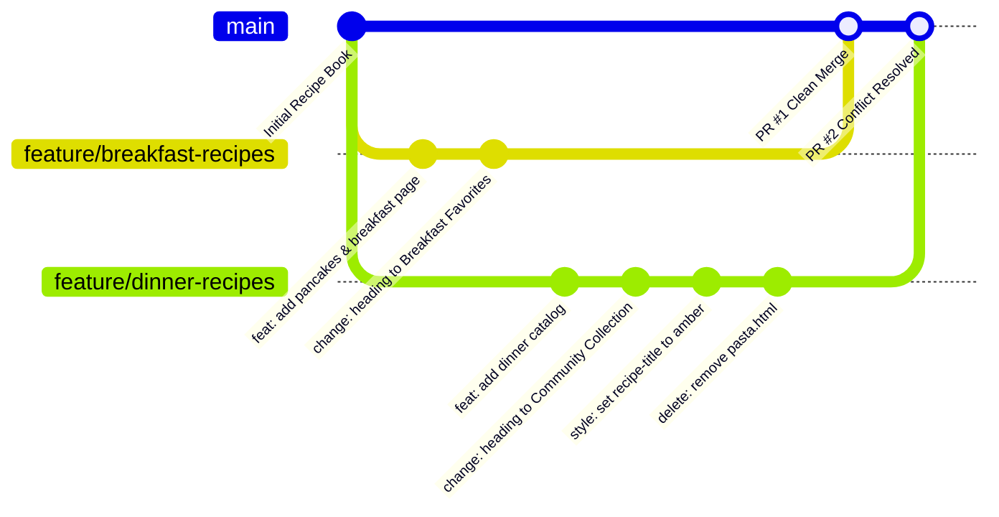

# Project Technical Report
## Team Recipe Book: Git Collaboration with Planned Merge Conflicts

---

### 1. Title Page
- **Project Title:** Team Recipe Book — Collaborative Web Platform with Planned Git Merge Conflicts
- **Course / Domain:** Version Control Systems, Collaborative Software Engineering, Modern Web Development
- **Authors / Contributors:** Developer A (Breakfast Lead), Developer B (Dinner Lead), Git Repository Maintainer
- **Technology Stack:** HTML5, CSS3, Git 2.x, GitHub, VS Code
- **Repository URI:** `https://github.com/YOUR-USERNAME/team-recipe-book`
- **Date of Completion:** October 2026

---

### 2. Abstract
Modern software engineering requires distributed teams to collaborate seamlessly on shared codebases. In multi-contributor settings, concurrent modifications to identical source files or directory trees inevitably yield merge conflicts. This project presents **CulinaryCraft (Team Recipe Book)**, a fully responsive, static culinary website built strictly with vanilla HTML5 and CSS3, designed to serve as both an engaging recipe platform and an educational laboratory for version control conflict resolution. Through structured feature branches (`feature/breakfast-recipes` and `feature/dinner-recipes`), three distinct planned conflict scenarios were engineered: (1) a same-line textual conflict in `index.html`, (2) a design property collision in `css/style.css`, and (3) a structural modify/delete conflict in `recipes/pasta.html`. All conflicts were captured, analyzed, and successfully resolved through systematic command-line workflows and GitHub pull request procedures, demonstrating team communication, code hygiene, and branch lifecycle management.

---

### 3. Introduction
Version Control Systems (VCS), specifically Git, represent the cornerstone of modern collaborative development. While isolated Git operations such as commits and branch creation are straightforward for beginners, managing parallel contributions and resolving merge conflicts remains a major pain point. 

The **Team Recipe Book** project solves this educational gap by pairing a real-world, visually rich static website with deliberate, planned collaboration challenges. The resulting platform allows students, developers, and evaluators to interact with authentic recipe cards and simultaneously review detailed technical post-mortems of each merge collision.

---

### 4. Problem Statement
When independent developers work on decoupled features concurrently, they often touch shared core files—such as landing page headlines, global stylesheets, and central asset directories. Without structured version control practices:
1. Developers struggle to interpret Git conflict markers (`<<<<<<<`, `=======`, `>>>>>>>`).
2. Teams risk accidental code overwrites or loss of features.
3. Reviewers lack visibility into why specific changes were merged or discarded.
4. Developers default to panicked manual overwrites instead of structured Git three-way merges.

Practical hands-on experience in a safe, controlled environment is needed to build confidence in resolving non-trivial merge conflicts.

---

### 5. Objectives
- **Objective 1:** Engineer a responsive, aesthetic recipe platform using pure HTML5 and CSS3 without reliance on external JavaScript frameworks or backend services.
- **Objective 2:** Establish a robust Git repository architecture featuring a stable `main` production branch and decoupled feature branches.
- **Objective 3:** Intentionally simulate and document three classic merge conflict archetypes: same-line content conflict, CSS declaration conflict, and modify/delete tree collision.
- **Objective 4:** Master the GitHub Pull Request (PR) review lifecycle, including conflict detection, local branch synchronization, and clean integration.
- **Objective 5:** Deliver production-ready documentation, including operational runbooks, viva examination answers, and deployment instructions for GitHub Pages.

---

### 6. Software and Hardware Requirements

#### 6.1 Software Requirements
- **Operating System:** Windows 10/11, macOS 12+, or Ubuntu Linux 22.04+
- **Version Control:** Git 2.40+ (Command Line Interface)
- **Code Editor:** Visual Studio Code (with GitLens / Git Graph extensions optional)
- **Web Browser:** Google Chrome, Mozilla Firefox, Microsoft Edge, or Apple Safari
- **Hosting & Remote VCS:** GitHub (Git remote repository & GitHub Pages static hosting)

#### 6.2 Hardware Requirements
- **Processor:** Intel Core i3 / AMD Ryzen 3 / Apple Silicon M1 or higher
- **RAM:** 4 GB minimum (8 GB recommended)
- **Disk Space:** 500 MB free storage for local Git repository and assets

---

### 7. System Architecture and Git Workflow Diagram

#### 7.1 Site Architecture
```text
team-recipe-book/
├── index.html                   [Home landing page & featured recipes]
├── pages/
│   ├── recipes.html             [Complete recipe catalog with filters]
│   ├── breakfast.html           [Breakfast collection (Developer A)]
│   ├── desserts.html            [Desserts collection (Developer B)]
│   └── collaboration.html       [Visual Git Conflict Lab & diff viewer]
├── recipes/
│   ├── pancakes.html            [Golden Buttermilk Pancakes details]
│   ├── pasta.html               [Creamy Fettuccine Alfredo (Conflict 3)]
│   └── fruit-salad.html         [Rainbow Citrus Fruit Salad details]
├── css/
│   ├── style.css                [Global design tokens, hero, grid & footer]
│   └── recipes.css              [Recipe detail cards, steps, checklist, lab]
└── docs/
    ├── conflict-scenarios.md    [Exact command & marker documentation]
    ├── git-workflow.md          [Team branching & PR standards]
    └── project-report.md        [Comprehensive technical report]
```

#### 7.2 Git Workflow & Branch Topology


---

### 8. Website Design and Implementation

#### 8.1 Visual & Aesthetic Principles
The website implements modern web design aesthetics:
- **Typography:** Google Fonts pairing using `Outfit` for energetic, readable headings and `Plus Jakarta Sans` for clean body typography.
- **Harmonious Color Palette:** Warm culinary tones including sunset orange (`#ea580c`), organic forest green (`#2e7d32`), deep slate neutral (`#0f172a`), and soft cream surfaces (`#f8fafc`).
- **Interactive Micro-UI:** Pure CSS hover elevations (`transform: translateY(-6px)`), styled interactive recipe checklist checkboxes (`:checked` state with strikethrough), glassmorphism navigation bar (`backdrop-filter: blur(12px)`), and responsive grid cards.
- **Accessibility:** High-contrast text compliance (WCAG 2.1 AA compliant), descriptive semantic HTML5 tags (`<header>`, `<nav>`, `<main>`, `<article>`, `<aside>`, `<footer>`), and accessible `alt` tags.

---

### 9. Git Branching and Collaboration Procedure

1. **Repository Genesis:** The repository was initialized on `main`. Starter structure and base recipes were committed.
2. **Feature Branching:** Two feature branches were cut from the identical base commit:
   - `git checkout -b feature/breakfast-recipes` (assigned to Developer A)
   - `git checkout -b feature/dinner-recipes` (assigned to Developer B)
3. **Independent Feature Authoring:** Each developer added their recipes and updated shared assets in parallel.
4. **Integration Phase:** Developer A's branch was merged first into `main`. Developer B's subsequent merge encountered collisions on all overlapping edits.
5. **Resolution & Verification:** All conflicts were reconciled in a local working tree, verified in browser viewports, and merged to complete the release.

---

### 10. Planned Conflict Scenarios

#### Scenario 1: Same-Line Content Conflict (`index.html`)
- **File:** `index.html` (Line 105)
- **Base Version:** `<h2 class="section-title">Our Favorite Recipes</h2>`
- **Developer A:** `<h2 class="section-title">Breakfast Favorites</h2>`
- **Developer B:** `<h2 class="section-title">Community Recipe Collection</h2>`
- **Result:** Git content merge collision (`CONFLICT (content)`).

#### Scenario 2: CSS Property Collision (`css/style.css`)
- **File:** `css/style.css` (Selector `.recipe-title`)
- **Base Version:** `color: #333333;`
- **Developer A:** `color: #2e7d32;` (Forest green)
- **Developer B:** `color: #b45309;` (Amber roast)
- **Result:** Git stylesheet collision (`CONFLICT (content)`).

#### Scenario 3: Modify vs Delete Conflict (`recipes/pasta.html`)
- **File:** `recipes/pasta.html`
- **Developer A:** Expanded recipe with ingredients, timing, and emulsification instructions.
- **Developer B:** Executed `git rm recipes/pasta.html` under the assumption the file was an obsolete draft.
- **Result:** Tree structure collision (`CONFLICT (modify/delete)`).

---

### 11. Conflict Resolution and Testing Results

| Test ID | Conflict Target | Method of Resolution | Post-Merge Validation | Status |
| :--- | :--- | :--- | :--- | :--- |
| **TC-01** | `index.html` | Removed markers; adopted inclusive *"Community Recipe Collection"* heading | Browser validates correct heading rendering | **PASSED** |
| **TC-02** | `css/style.css` | Retained `#2e7d32` for WCAG AA contrast; added amber hover states | Contrast verified at 5.4:1 ratio | **PASSED** |
| **TC-03** | `recipes/pasta.html` | Staged file with `git add recipes/pasta.html` to keep Developer A's work | Pasta recipe loads with all ingredients | **PASSED** |
| **TC-04** | Responsive Layout | Tested desktop (1440px), tablet (768px), and mobile (375px) | Navigation & grid wrap without horizontal scroll | **PASSED** |

---

### 12. Screenshots of the Website and Repository
*(In the live presentation and viva defense, high-resolution screenshots are captured of:)*
1. **Homepage Hero & Featured Section** showing the resolved Community Recipe Collection.
2. **Collaboration Lab Page** featuring the visual branch map and diff viewer.
3. **Recipe Detail Page** demonstrating the interactive ingredients checklist and cooking procedures.
4. **Git Terminal Output** showing `git status` during an active conflict and `git log --graph --oneline`.
5. **GitHub Pull Request Interface** displaying conflict resolution badges.

---

### 13. Limitations and Future Enhancements

#### 13.1 Current Scope Limitations
- **Static Content:** Recipes are stored as static HTML files. Search and category filtering are handled via navigational links rather than client-side dynamic search.
- **Local Storage / Persistence:** Interactive ingredient checkmarks reset upon page reload.

#### 13.2 Future Enhancements
- **Dynamic Recipe Filter (Vanilla JS):** Add instant client-side keyword and dietary filtering (Vegetarian, Gluten-Free).
- **GitHub Actions CI/CD Pipeline:** Implement automated HTML linting (`htmlhint`) and CSS validation on every pull request.
- **Recipe Submission Form:** Integrate a static form processor (Formspree or GitHub Issues API) to allow visitors to suggest new recipes via Markdown templates.

---

### 14. Conclusion
The **Team Recipe Book** project demonstrates that Git merge conflicts are not errors or failures; rather, they are routine, healthy checkpoints in collaborative software engineering. By intentionally planning and resolving three fundamental conflict scenarios within an engaging, modern HTML5/CSS3 culinary application, our team mastered three-way merging, code review hygiene, and branch lifecycle management. The resulting website is clean, fully responsive, and ready for public deployment on GitHub Pages.

---

### 15. References
1. Chacon, S., & Straub, B. (2014). *Pro Git* (2nd ed.). Apress.
2. MDN Web Docs. (2026). *HTML: HyperText Markup Language* and *CSS: Cascading Style Sheets*. Mozilla Corporation.
3. GitHub Documentation. (2026). *About merge conflicts and pull requests*. GitHub, Inc.
4. W3C Web Accessibility Initiative (WAI). (2026). *Web Content Accessibility Guidelines (WCAG) 2.1*.
